<picture><source media="(prefers-color-scheme: dark)" srcset="assets/hero-dark.svg"></picture>

<a href="https://t.me/qvapelsin"><picture><source media="(prefers-color-scheme: dark)" srcset="assets/social-1-dark.svg"></picture></a>&nbsp;<a href="https://discord.com/qvapelsin"><picture><source media="(prefers-color-scheme: dark)" srcset="assets/social-2-dark.svg"></picture></a>

<picture><source media="(prefers-color-scheme: dark)" srcset="assets/about-dark.svg"></picture>

<picture><source media="(prefers-color-scheme: dark)" srcset="assets/stack-dark.svg"></picture>

<a href="https://github.com/qvap/Glossy-Shell"><picture><source media="(prefers-color-scheme: dark)" srcset="assets/project-glossy-shell-dark.svg"></picture></a>&nbsp;<a href="https://github.com/qvap/YAP--Lab-1"><picture><source media="(prefers-color-scheme: dark)" srcset="assets/project-yap-lab-1-dark.svg"></picture></a>

<a href="https://github.com/qvap/OOP--Lab-3.1"><picture><source media="(prefers-color-scheme: dark)" srcset="assets/project-oop-lab-3-1-dark.svg"></picture></a>&nbsp;<a href="https://github.com/qvap/OOP--Lab-3.2"><picture><source media="(prefers-color-scheme: dark)" srcset="assets/project-oop-lab-3-2-dark.svg"></picture></a>

<picture><source media="(prefers-color-scheme: dark)" srcset="assets/stats-dark.svg"></picture>

<picture><source media="(prefers-color-scheme: dark)" srcset="assets/wave-dark.svg"></picture>

<a href="https://github.com/qvap?tab=repositories"><picture><source media="(prefers-color-scheme: dark)" srcset="assets/button-1-dark.svg"></picture></a>

<a href="https://metawka.github.io/expressive-profile/?from=qvap"><picture><source media="(prefers-color-scheme: dark)" srcset="assets/credit-dark.svg"></picture></a>

